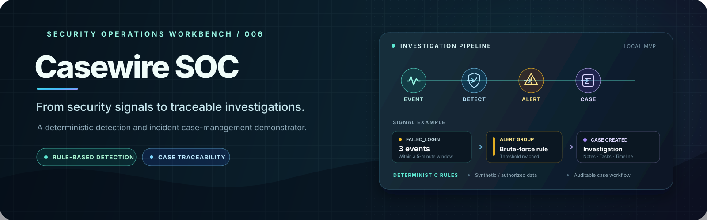

  

<h1 align="center">CASEWIRE SOC</h1>

  <strong>Detect patterns. Triage alerts. Track the investigation.</strong> 
  A deterministic, case-management demonstrator for security operations workflows.

  
  
  
  
  
  
  

  <a href="#overview">Overview</a> ·
  <a href="#what-is-implemented">Features</a> ·
  <a href="#architecture">Architecture</a> ·
  <a href="#api-reference">API</a> ·
  <a href="#windows-powershell-quick-start">Quick start</a> ·
  <a href="#testing">Testing</a> ·
  <a href="#security-boundaries-and-known-limitations">Limitations</a>

---

> [!IMPORTANT]
> **Project status: completed local MVP / portfolio demonstrator — not production-ready.** Casewire SOC contains a Spring Boot API, PostgreSQL persistence, a deterministic failed-login correlation rule, alert-to-case triage, case notes and response tasks, plus a React dashboard. It is designed to demonstrate the core workflow using synthetic or explicitly authorized data. The current code has no authentication or authorization layer, the dashboard includes mock fallback records, the development database configuration contains a sample password, and alert deduplication and input-hardening remain limited. Do not connect it to a real organizational SIEM or expose it to an untrusted network without further engineering.

## Overview

Security events become useful to an analyst when they can be reviewed in context, grouped according to explainable rules, assigned to an investigation, and followed through a response workflow.

**Casewire SOC** is a small Security Operations Center (SOC) case-management demonstrator built around that idea. It accepts individual normalized event records, evaluates a deterministic authentication-failure rule, turns generated alert groups into incident cases, and provides basic case tracking, analyst notes, response tasks, and timeline retrieval.

The goal is transparency over opaque detection: the initial rule is deliberately easy to understand and test. This is a learning and portfolio project, not a replacement for an enterprise SIEM, SOAR platform, or incident-response program.

## What is implemented

| Capability | Current behavior | Status |
|---|---|---|
| Normalized event intake | Accepts a JSON event with timestamp, event type, source reference, and optional network/identity fields. | Implemented |
| Persistent event store | Stores normalized events in PostgreSQL through Spring Data JPA. | Implemented |
| Time-window query | Finds events by event type, source IP, and inclusive timestamp range. | Implemented |
| Deterministic detection | Checks for at least three <code>FAILED_LOGIN</code> events from one source IP within five minutes. | Implemented |
| Alert grouping | Persists an alert group with a rule name, grouping key, trigger time, and description. | Implemented, deduplication limited |
| Alert-to-case triage | Creates a high-severity investigation case for an alert group if a case is not already found for that alert group. | Implemented |
| Case management | Lists cases and permits updates to status, severity, and owner fields. | Implemented |
| Analyst notes and response tasks | Adds notes and checklist-style tasks to a case; tasks can be marked complete. | Implemented |
| Case timeline endpoint | Returns the case's notes and response tasks ordered by creation time. | Implemented |
| React dashboard | Displays case rows and exposes basic refresh/status-update controls. | Implemented, demo fallback remains |
| Live SIEM integrations | No production connector or vendor adapter is currently included. | Not implemented |

### Scope by design

- **Synthetic-first:** use generated or sanitized event data during local development.
- **Explainable detection:** the initial brute-force-style rule is explicit and deterministic.
- **Workflow over collection:** the demonstrator focuses on event-to-alert-to-case handling, rather than high-volume ingestion.
- **No machine-learning claims:** detection does not depend on an opaque model.
- **No live SIEM requirement:** Splunk, LogRhythm, or other integrations are not currently implemented.

## Detection logic

The current <code>BruteForceDetectionRule</code> evaluates an incoming event as follows:

~~~mermaid
flowchart TD
    A[Normalized event submitted] --> B{eventType = FAILED_LOGIN?}
    B -- No --> N[No alert]
    B -- Yes --> C{source IP present?}
    C -- No --> N
    C -- Yes --> D[Query same event type and source IP]
    D --> E[Use event timestamp and preceding 5-minute window]
    E --> F{At least 3 matching events?}
    F -- No --> N
    F -- Yes --> G[Persist an alert group]
    G --> H[Analyst triages alert to incident case]
    H --> I[Update case, add notes, track response tasks]
~~~

**Rule parameters in the current source**

| Parameter | Current value |
|---|---|
| Matching event type | <code>FAILED_LOGIN</code> |
| Grouping key | Source IP address |
| Look-back window | Five minutes |
| Trigger threshold | Three matching events |
| Alert description | Matched event count and source IP |
| Detection approach | Synchronous and deterministic |

The query window uses the latest event's timestamp as its end and subtracts five minutes for its start. This makes the rule straightforward to explain and unit-test, but it is not a complete brute-force detection strategy. It does not currently correlate by username, destination, device, or successful logins following failures.

### Important alerting caveat

The current rule can create a new alert group every time another matching failure is processed after the threshold is met. There is no durable alert-suppression window, unique detection fingerprint, or idempotent deduplication key. The alert's <code>triggeredAt</code> uses server time rather than the event timestamp. Treat these alerts as a demonstration of threshold-based correlation, not as production-grade incident detection.

## Incident case workflow

~~~mermaid
flowchart LR
    E[Normalized Event] --> R[Correlation Rule]
    R --> A[Alert Group]
    A -->|Manual triage via API| C[Incident Case]
    C --> S[Status / Severity / Owner]
    C --> N[Analyst Notes]
    C --> T[Response Tasks]
    N --> TL[Case Timeline]
    T --> TL
~~~

The case model includes:

- **Status:** <code>OPEN</code>, <code>IN_PROGRESS</code>, <code>RESOLVED</code>, <code>CLOSED</code>
- **Severity:** <code>LOW</code>, <code>MEDIUM</code>, <code>HIGH</code>, <code>CRITICAL</code>
- **Owner:** a free-form analyst/owner string
- **Notes:** content and an author string with a timestamp
- **Response tasks:** task name, completion flag, creation time, and optional completion time
- **Alert association:** a case references the alert-group ID that initiated triage

Triage assigns a title derived from the alert rule and defaults the case severity to <code>HIGH</code>. The service first looks for an existing case by alert-group ID, and the database model declares that field unique.

**The current case update endpoint assigns requested enum values directly.** It does not enforce a formal state-transition graph or validate role permissions. The note author is supplied by the request rather than a verified authenticated identity. These are known MVP constraints.

## Architecture

~~~mermaid
flowchart TB
    subgraph Client["Frontend"]
      UI[React 19 + TypeScript]
      VITE[Vite development server]
    end
    subgraph Backend["Backend API"]
      MVC[Spring Boot REST Controllers]
      ES[Event Service]
      STORE[Event Store / Repository]
      RULE[Deterministic Brute-Force Rule]
      CS[Case Service]
      REPO[Spring Data JPA Repositories]
    end
    DB[(PostgreSQL)]
    UI --> VITE
    VITE -->|/api proxy| MVC
    MVC --> ES
    ES --> STORE
    ES --> RULE
    STORE --> REPO
    RULE --> REPO
    MVC --> CS
    CS --> REPO
    REPO --> DB
~~~

| Layer | Technology / responsibility |
|---|---|
| Language | Java 21 configured in Maven; TypeScript in the frontend |
| Backend framework | Spring Boot, Spring MVC, Spring Data JPA |
| Persistence | Hibernate/JPA with PostgreSQL |
| Detection | Explicit Java service rule with a five-minute query window |
| Frontend | React 19, TypeScript, Vite, Axios |
| Styling | Tailwind CSS dependency and project styles |
| Tests | JUnit 5, Spring Boot test support, Mockito, AssertJ |
| Local frontend routing | Vite proxies <code>/api</code> requests to <code>http://localhost:8080</code> |
| License | MIT |

The backend dependencies and Java target are specified in <code>pom.xml</code>. The frontend's Node/npm dependencies and build scripts are defined in <code>frontend/package.json</code> and the committed <code>frontend/package-lock.json</code>.

## API reference

The current backend exposes the following routes.

| Method | Route | Purpose |
|---|---|---|
| <code>POST</code> | <code>/api/events/import</code> | Validate required event fields, persist a normalized event, then synchronously evaluate the detection rule |
| <code>GET</code> | <code>/api/cases</code> | List all incident cases |
| <code>POST</code> | <code>/api/cases/triage/{alertId}</code> | Triage an alert group into an incident case |
| <code>PATCH</code> | <code>/api/cases/{caseId}</code> | Update case status, severity, and/or owner |
| <code>POST</code> | <code>/api/cases/{caseId}/notes</code> | Add an analyst note |
| <code>POST</code> | <code>/api/cases/{caseId}/tasks</code> | Add a response task |
| <code>PATCH</code> | <code>/api/cases/tasks/{taskId}/complete</code> | Mark a response task completed |
| <code>GET</code> | <code>/api/cases/{caseId}/timeline</code> | Retrieve notes and tasks for a case |

### Example: import a normalized event

Send a JSON body to <code>POST /api/events/import</code>:

~~~json
{
  "eventTimestamp": "2026-10-23T10:15:00Z",
  "eventType": "FAILED_LOGIN",
  "sourceIp": "192.0.2.45",
  "destinationIp": "192.0.2.20",
  "username": "synthetic-user-01",
  "hostname": "workstation-demo",
  "sourceReferenceId": "demo-auth-log-0003"
}
~~~

The timestamp should be an ISO-8601 instant. The service currently requires <code>eventTimestamp</code>, a non-blank <code>eventType</code>, and a non-blank <code>sourceReferenceId</code>. Other fields are optional. This example is synthetic and uses documentation-only IP ranges.

A successful import returns a status and the saved event's generated identifier. Validation failures represented as <code>IllegalArgumentException</code> return HTTP 400 with a message.

### Endpoint limitations

- There is no authentication or authorization configuration in the current application.
- There is no dedicated event-batch/file-import endpoint; <code>/api/events/import</code> accepts one normalized event per request.
- <code>GET /api/cases</code> returns the case collection without a pagination/filter contract.
- Case timeline currently combines notes and tasks; it does not provide a unified, immutable audit log of every action.
- Error handling is endpoint-level and limited; do not assume a comprehensive, uniform API error contract.

## Windows PowerShell quick start

The following steps describe the current **local development** setup. Use disposable or synthetic data only.

### Prerequisites

- JDK matching Java 21
- PostgreSQL with a local database role you control
- Node.js and npm compatible with the committed frontend lockfile
- Windows PowerShell
- Git

### 1. Clone the repository

~~~powershell
git clone https://github.com/tracolerd/casewire-soc.git
Set-Location .\casewire-soc
~~~

### 2. Create the local PostgreSQL database

If <code>psql</code> is installed and available on your <code>PATH</code>, create the development database:

~~~powershell
psql -U postgres -c "CREATE DATABASE casewire_soc;"
~~~

If the database already exists, do not drop or recreate it. The current configuration uses the database name <code>casewire_soc</code>.

### 3. Override the sample database credentials

The tracked <code>src/main/resources/application.properties</code> now reads the datasource password from <code>SPRING_DATASOURCE_PASSWORD</code> instead of committing a default password. The local URL/username remain configurable; Hibernate <code>ddl-auto=update</code> is still only appropriate for this prototype.

Override them in the same PowerShell session used to run Maven. Replace the sample password with the password for your local database role:

~~~powershell
$env:SPRING_DATASOURCE_URL = "jdbc:postgresql://localhost:5432/casewire_soc"
$env:SPRING_DATASOURCE_USERNAME = "postgres"
$env:SPRING_DATASOURCE_PASSWORD = "REPLACE_WITH_YOUR_LOCAL_DATABASE_PASSWORD"
~~~

The environment variables override the corresponding Spring datasource properties. Do not commit real credentials or reuse the sample password in any shared environment.

### 4. Start the backend

From the repository root:

~~~powershell
.\mvnw.cmd spring-boot:run
~~~

Spring Boot serves the API on port <code>8080</code> by default. Keep this terminal running. The application uses Hibernate schema auto-update for local MVP development; a migration-based schema lifecycle is not currently configured.

### 5. Run the backend tests

In a PowerShell terminal at the repository root, ensure the datasource environment variables from step 3 are set and that PostgreSQL is running. Then run:

~~~powershell
.\mvnw.cmd test
~~~

Some test classes use <code>@SpringBootTest</code> and exercise Spring Data JPA against the configured database. A test result is only meaningful when the tests actually execute against an available test/development database. Use a disposable test database when you do not want test data touching your development records.

### 6. Start the React dashboard

Open a second PowerShell terminal at the repository root:

~~~powershell
Set-Location .\frontend
npm ci
npm run dev
~~~

Open the local URL printed by Vite, typically <code>http://localhost:5173</code>. The development-server configuration proxies <code>/api</code> calls to <code>http://localhost:8080</code>; keep the backend running.

To compile the frontend, run:

~~~powershell
npm run build
~~~

The frontend's <code>package.json</code> also defines <code>npm run lint</code>.

## Testing

JUnit tests are present for application context loading, event validation and service behavior, time-window querying, brute-force rule thresholds, alert-to-case triage, case updates, and repository persistence.

The repository contains a test suite, but **no GitHub Actions workflow is currently configured in the repository**. This README therefore does not claim a green CI run, a verified release pipeline, or a current pass count from an automated remote build. Run the commands above in a correctly configured environment and review the actual output.

Testing represented in source includes:

- Rule threshold behavior and below-threshold behavior using mocks.
- Required event fields and confirmation that invalid events are not persisted in service tests.
- Time-window filtering of events by type, source IP, and timestamp.
- Alert-group-to-case triage and case status/owner updates.
- Database-backed repository tests using Spring's test context.

The test suite does not establish production readiness, security hardening, high-volume event ingestion, concurrency-safe alert suppression, or full frontend/API end-to-end coverage.

## Security boundaries and known limitations

This section is intentionally direct: **Casewire SOC is a local portfolio demonstrator, not a hardened SOC platform.**

### Configuration and access control

- The tracked application properties file requires the database password to come from the environment and enables Hibernate schema auto-update. Keep credentials out of source control; before any shared deployment, enforce a proper migration strategy and review the broader authentication/authorization gaps.
- No authentication, authorization, user provisioning, or role-based access control is implemented. API endpoints are not protected by an identity layer.
- Analyst-note authors and case owners are free-form request fields, not verified identities.
- There is no deployment profile, production secret manager setup, or HTTPS/reverse-proxy hardening guide.

### Detection and case integrity

- The brute-force-style rule uses source IP, event type, threshold, and a five-minute window only. It may miss distributed attacks or produce false positives.
- There is no alert deduplication or suppression window, so repeated qualifying events may create repeated alert groups.
- The alert trigger time uses server time, not the latest event timestamp.
- Case triage is designed to find an existing case for an alert group, but simultaneous requests and conflict recovery are not comprehensively handled.
- Case status updates are not restricted by a central transition policy.
- Event ingestion validates only a small set of required fields and has no explicit batch-size, rate-limit, or high-volume backpressure contract.

### Frontend behavior

- The dashboard seeds example rows and uses a mock preview when fetching cases fails. It also keeps its seeded list when a successful API response contains no cases. Consequently, visible sample cases are not proof that persisted backend records exist.
- API failures and failed status updates are currently reported to the browser console rather than through a complete user-facing error workflow.
- The interface is a minimal dashboard, not a full alert investigation console with event drill-down, filtering, pagination, authentication, or evidence management.

### Operational gaps

- Real Splunk/LogRhythm or other SIEM ingestion adapters are not implemented.
- There is no GitHub Actions CI workflow currently checked into the repository.
- Alert-suppression, case-history auditability, schema migrations, production monitoring, backups/recovery, and deployment automation remain outside the current MVP.
- No independent penetration test or production validation is represented by this repository.

Use synthetic or sanitized events only, keep the application local, and do not interpret a generated alert as proof of a security incident.

## Repository map

~~~text
.
├── src/
│   ├── main/
│   │   ├── java/com/casewire/soc/
│   │   │   ├── alert/       # Alert-group entity and deterministic detection rule
│   │   │   ├── cases/       # Incident cases, notes, response tasks, API and service
│   │   │   └── event/       # Normalized events, import endpoint and time-window store
│   │   └── resources/
│   │       └── application.properties
│   └── test/java/com/casewire/soc/
│       ├── alert/           # Correlation-rule tests
│       ├── cases/           # Case service and repository tests
│       └── event/           # Event import and time-window tests
├── frontend/
│   ├── src/
│   │   ├── components/      # React dashboard
│   │   └── services/        # API client and case types
│   ├── package.json
│   ├── package-lock.json
│   └── vite.config.ts       # Local /api proxy to Spring Boot
├── docs/
│   ├── DECISIONS.md
│   └── PROJECT_STATE.md
├── .mvn/
├── mvnw
├── mvnw.cmd
├── pom.xml
└── LICENSE
~~~

---

## Creator, Developer & Maintainer

**Created, designed, developed, and maintained by [Nurul Faiyaz](https://github.com/tracolerd).**

This project is independently built and maintained by Nurul Faiyaz.

  
  
  
  
  
  
  

  <a href="https://www.facebook.com/faiyaz.888">Facebook</a> ·
  <a href="https://www.instagram.com/tracolerd">Instagram</a> ·
  <a href="https://www.linkedin.com/in/faiyaz-xyz">LinkedIn</a> ·
  <a href="https://x.com/faiyaz_explores">X / Twitter</a> ·
  <a href="https://github.com/tracolerd">GitHub</a> ·
  <a href="mailto:scrollfaiyaz@gmail.com">Email</a> ·
  <a href="https://nurul-faiyaz.netlify.app/">Portfolio</a>

## License

MIT. See [LICENSE](LICENSE).

---

Portfolio catalog · Project 08 of 22 · <a href="https://github.com/tracolerd">Nurul Faiyaz</a>

